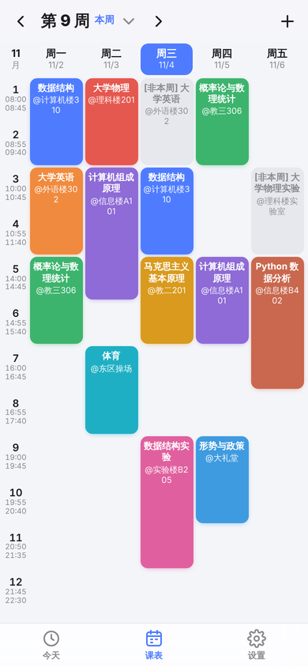
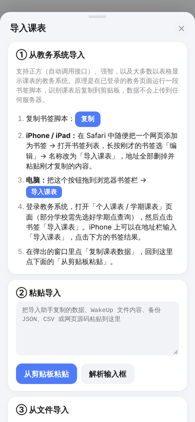
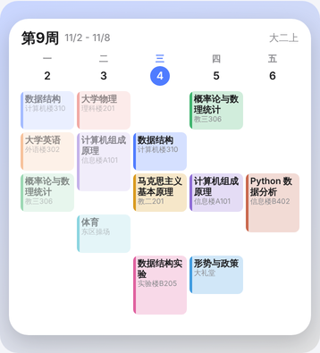

# 课表 · 无广告的课程表 PWA

一个**纯前端、零依赖、无广告**的课程表 Web App。可以添加到 iPhone 主屏幕当 App 用，支持从教务系统 / WakeUp 课程表导入，并能导出 [Scriptable](https://apps.apple.com/app/scriptable/id1405459188) 脚本做成 iOS 桌面小组件，不需要 99 美元的开发者账号。

> 起因：受够了某课程表 App 的开屏广告 🙃

<p>
  
  
  
</p>

<p>
  
  
  
</p>
<p>
  
  
</p>

## 功能

- **今天**：当前第几周、正在上的课（带进度条）、下一节倒计时、今天和明天的课程
- **周课表**：左右滑动切换周次，点击周次可快速跳转；单双周、非本周课程以灰色显示；点空白格添加课程，点课程查看 / 编辑 / 删除
- **导入**
  - 教务系统：书签脚本，在已登录的教务页面一键识别（正方自动调用接口、强智、以及大多数表格形式的课表）
  - WakeUp 课程表导出的 `.wakeup_schedule` 文件（课程、颜色、作息时间、开学日期一起导入）
  - CSV（WakeUp 模板格式）、本应用的 JSON 备份、分享链接、保存的课表网页 HTML
- **导出**：Scriptable 小组件脚本、分享链接、系统日历 `.ics`、JSON 备份、CSV
- **iOS 小组件**（基于 Scriptable）：小 / 中 / 大号、大号整周视图、锁屏圆形 / 矩形 / 单行组件，自动适配深色模式；点击小组件跳转到网页版查看完整课表
- 作息时间自定义（支持一键生成）、学期周数、周末显示、深色模式、离线可用
- 数据只保存在本机浏览器（localStorage）里，没有服务器、没有统计、没有广告

## 快速开始

### 1. 部署（GitHub Pages，免费）

1. Fork 本仓库（或直接用你自己的仓库）
2. 仓库 **Settings → Pages → Build and deployment**，Source 选 **Deploy from a branch**，Branch 选 `main`、目录 `/ (root)`，保存
3. 稍等一两分钟，访问 `https://<你的用户名>.github.io/<仓库名>/`

本项目没有构建步骤，任何静态文件服务器都能部署（Vercel、Netlify、Cloudflare Pages、自己的服务器……）。注意两点：

- 必须是 **HTTPS**（PWA、剪贴板等功能都需要安全上下文）
- `.js` 文件需要以 UTF-8 返回（GitHub Pages 默认如此）。书签脚本会被注入到 GBK 编码的教务页面里，编码不对会导致脚本报错

### 2. 添加到 iPhone 主屏幕

用 **Safari** 打开部署好的网址 → 点底部「分享」→「添加到主屏幕」。之后就可以像普通 App 一样全屏使用，没有地址栏，也能离线打开。

### 3. 导入课表

打开 App →「设置」→「导入课表」，按页面上的步骤操作。教务系统导入的原理是：在你已经登录的教务课表页面里运行一小段脚本。脚本会弹出「课表导入助手」，识别出课表后点「复制课表数据」，再回到课表 App 点「从剪贴板粘贴」，确认导入并选择「这周是第几周」。

运行这段脚本有两种方式：

- **快捷指令（iPhone / iPad 推荐）**：添加 [「导入课表」快捷指令](https://www.icloud.com/shortcuts/48bc18b94a7e4d46a095c80b31ea3036)。在 Safari 中打开教务（或校园门户）的课表页面，点分享按钮，选「导入课表」。**运行后不会直接复制**：网页上会弹出「课表导入助手」窗口，点里面的「复制课表数据」。这个快捷指令加载的是本项目官方站点 `qlsalj.github.io/course` 上的脚本；自己部署的话，可以按 App 里「手动创建快捷指令」的步骤，粘贴 App 里复制的代码自己建一个。
- **书签脚本**：电脑上把按钮拖到书签栏即可。iPhone 上也可以存成 Safari 书签，但**必须从书签列表（📖）里点**。在地址栏输入或搜索书签名会被 iOS 拦截，提示「无法运行脚本，因为不允许以此方式使用 JavaScript」。

整个过程都在你自己的浏览器里完成，数据不会经过任何第三方服务器。

| 教务系统 | 支持情况 |
| --- | --- |
| 正方教务（新版 `jwglxt`） | ✅ 自动调用课表接口，最准确；支持 webvpn |
| 正方教务（网页课表） | ✅ 解析 `timetable_con` 结构 |
| 强智教务（`jsxsd`） | ✅ 解析 `kbtable` / `kbcontent` |
| 其它以表格显示的课表（URP、金智、自研系统……） | ⚠️ 通用表格识别，支持「课程名[班号] 周次 (节次) 教师 地点」等一行多字段写法，个别需要适配 |

识别不出来或识别错误？在导入助手里点「复制页面源码」，**删掉学号、姓名等个人信息**后到 [Issues](../../issues) 反馈，或者直接提 PR 改进 [`jw/parsers.js`](jw/parsers.js)。

从 WakeUp 迁移：WakeUp → 右上角菜单 →「导出」→「导出为 WakeUp 课程表文件」，把文件存到「文件」App，再在本 App「导入课表」→「选择文件」。

### 4. 桌面小组件（Scriptable）

1. App Store 安装免费的 [Scriptable](https://apps.apple.com/app/scriptable/id1405459188)
2. 课表 App →「设置」→「iOS 桌面小组件」，预览各个尺寸的效果，点「复制 Scriptable 脚本」
3. 打开 Scriptable → 右上角 `+` 新建脚本 → 粘贴 → 保存（可以把脚本名改成「课表」）
4. 桌面长按 → 添加小组件 → Scriptable → 选尺寸；长按小组件「编辑小组件」→ **Script** 选择刚才的脚本
5. 可选的 **Parameter**：
   - `week`：大号组件显示整周课表
   - `tomorrow`：显示明天的课程

锁屏组件同理（iOS 16+）。

#### 关于点击小组件跳转

iOS 不允许通过链接直接唤起「添加到主屏幕」的 Web App，点击小组件会用 **Safari** 打开网页版。另外 Safari 和主屏幕 Web App 的存储是分开的。为此，小组件的跳转链接里带了一份压缩后的课表数据（`#/today?s=...`），所以在 Safari 里打开也能直接看到完整课表：

- Safari 里没有数据，或者链接里的数据更新：自动保存这份数据
- Safari 里的数据更新：保留 Safari 里的数据，并提示你重新导出小组件

> 小组件里的课表是**导出那一刻的副本**。修改课表后，需要重新复制脚本、在 Scriptable 里覆盖原内容。

## 隐私

- 所有课表数据只存在你设备的浏览器存储中
- 书签脚本只在你主动点击时运行，读取的是当前页面内容，或者用你自己的登录状态请求教务系统的课表接口（正方）。识别结果只会复制到剪贴板
- 分享链接 / 小组件链接把课表数据放在 URL 的 `#` 之后，**不会发送给服务器**；但请注意不要把链接分享给不信任的人

## 开发

```bash
npm start          # 本地静态服务器（tools/serve.mjs），然后访问 http://localhost:8080
npm test           # 单元测试（Node 18+，无依赖）
npm run e2e        # 端到端测试，需要先 npm start，并且能 require('playwright')
npm run icons      # 由 icons/icon.svg 重新生成 PNG 图标（需要 playwright）
```

没有框架、没有打包，原生 ES Modules，改完刷新就能看到效果。

```
index.html               入口
css/app.css              样式（自动深色模式）
js/
  app.js                 启动、路由、处理链接中的数据
  store.js               数据模型、本地存储、颜色分配
  time.js                日期 / 周次计算
  importers.js           导入格式识别（WakeUp / CSV / JSON / HTML / 链接）
  exporters.js           导出（ICS / CSV / JSON / 小组件脚本 / 分享链接）
  share.js               课表数据 <-> URL（deflate + base64url）
  widget-preview.js      Scriptable API 的迷你模拟实现：App 内预览 + 测试
  views/                 今天 / 课表 / 设置
  sheets/                课程编辑、导入、小组件导出弹层
jw/
  parsers.js             教务系统课表解析（普通脚本，PWA 和教务页面共用）
  importer.js            注入教务页面的「课表导入助手」界面
scriptable/widget.js     Scriptable 小组件模板（导出时填入数据）
sw.js                    Service Worker（网络优先，离线回退到缓存）
tests/                   单元测试、端到端测试、各教务系统的样例页面
```

### 适配新的教务系统

1. 把课表页面的 HTML 存到 `tests/fixtures/xxx.html`（删除个人信息）
2. 在 `jw/parsers.js` 里改进通用表格解析，或者新增专用解析函数（参考 `parseZhengfangJson`）
3. 在 `tests/parsers.test.js` 加上测试，`npm test`

### 修改小组件

`scriptable/widget.js` 是一个完整的 Scriptable 脚本，`/*@DATA*/null` 这样的标记会在导出时被替换成真实数据。改完后在 App 的「iOS 桌面小组件」里就能看到预览（预览基于 `js/widget-preview.js` 对 Scriptable 布局的近似模拟，最终效果以真机为准）。

## License

[MIT](LICENSE)
